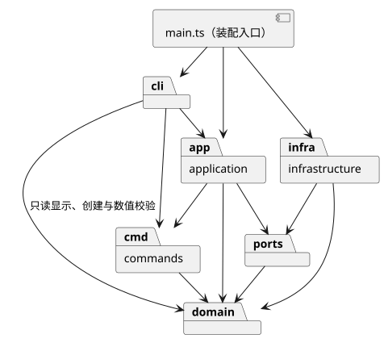
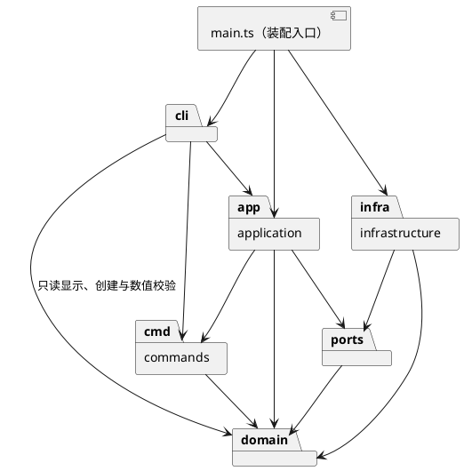

# Lab1 Phase 1：SVG 编辑器（CLI）

仓库：<https://github.com/LetSets/svg-editor-lab1>（私有）。实现语言：TypeScript。

本项目使用 AI 智能体 Codex 协作实现。本文记录实际架构、实现决策、开发过程和验证结果；不将尚未进行的人工确认或浏览器视觉检查描述为已完成。

## 1. 架构方案

### 1.1 功能范围与使用方式

实现 Phase 1 的六种内置图形 `rect / circle / ellipse / line / text / g`，以及全部 19 个命令名：

| 类别 | 命令 | 行为 |
| --- | --- | --- |
| 文档 | `init [w] [h]`、`read <file.svg>`、`save [file.svg]`、`canvas [w h]` | 新建、读取、保存、查询/修改尺寸 |
| 编辑 | `create`、`delete`、`move`、`scale`、`set` | 创建、删除、增量平移、位置与尺寸等比缩放、白名单属性修改 |
| 层级与顺序 | `group`、`ungroup`、`addto`、`front`、`back` | 分组、解组、移动归属、同级 z-order |
| 显示 | `tree [id]`、`show <id>`、`help` | 结构及内联属性、单图形明细、完整语法 |
| 历史 | `undo`、`redo` | 每条成功编辑为一个撤销单元 |

`create` 的参数：

```text
create rect <id> <x> <y> <w> <h> [fill]
create circle <id> <cx> <cy> <r> [fill]
create ellipse <id> <cx> <cy> <rx> <ry> [fill]
create line <id> <x1> <y1> <x2> <y2> [stroke]
create text <id> <x> <y> "content"
create g <id>
```

所有类型均可追加 `in <containerId>`。`box` 和插件系统属于后续阶段，当前 `create box` 返回未知类型错误。

运行环境为 Node.js 22 或更高版本；依赖版本以 `package-lock.json` 为准。本地验证环境为 Node.js 24.10.0。

```sh
npm ci
npm run cli
# 在 svg> 提示符下输入命令，Ctrl-D 退出

# 从工程根目录回放课程的两节点流程图
npm run cli < examples/flowchart.commands

npm run check
npm test
npm run build
node dist/main.js
```

交互模式显示 `svg>` 提示符。脚本模式按行执行，不输出提示符；出现错误仍继续执行后续行，最终以非零退出码结束。`#` 仅在行首（允许前导空白）表示注释，因此十六进制颜色不受影响。双引号内支持空格、空字符串、转义双引号和反斜杠。

示例输出：[flowchart.svg](../examples/flowchart.svg)。外部 SVG 读取样本：[other.svg](../examples/other.svg)。

### 1.2 模块划分

| 目录 | 主要类/接口 | 职责 |
| --- | --- | --- |
| `src/domain/` | `Shape`、`LeafShape`、`Rect`、`Circle`、`Ellipse`、`Line`、`TextShape`、`Group`、`SvgDocument`、`ShapeFactory` | 图形行为、多态、属性校验、树结构与 id 约束、对象创建 |
| `src/commands/` | `Command`、`EditCommand` 及九个具体命令类 | 将编辑封装为对象，隔离执行，保存撤销/重做快照 |
| `src/application/` | `EditorSession`、`History` | 当前文档与路径、用例协调、撤销栈和重做栈、IO 历史边界 |
| `src/ports/` | `DocumentStore` | 外部文档存储的接口 |
| `src/infrastructure/` | `SvgCodec`、`FileDocumentStore` | XML 与领域对象转换、SVG 序列化、文件读取和原子替换保存 |
| `src/cli/` | `Tokenizer`、`Arguments`、`CommandDispatcher`、`TreeFormatter`、`Repl` | 命令解析与分发、参数校验、终端交互和显示格式 |
| `src/main.ts` | 装配入口 | 连接具体存储、会话和 CLI，启动程序 |
| `tests/` | 四个测试文件 | 领域、历史、读写、CLI 端到端测试 |

每个类独立文件且文件名与类名相同。接口单独放在同名文件，`main.ts` 仅进行对象装配。几何属性、样式和子节点字段封装在对象内部；对外返回属性副本或子节点数组副本。`EditorSession.document` 返回克隆，避免展示层直接改变活动文档。

PlantUML 包图（已在本地渲染并检查，原文件见 [architecture.puml](architecture.puml)）：



可编辑源码：



### 1.3 设计模式的选择与落地

**Command（课程强制）。** `Command` 定义 `execute / undo / redo`。具体类包括 `CreateCommand`、`DeleteCommand`、`MoveCommand`、`ScaleCommand`、`SetCommand`、`GroupCommand`、`UngroupCommand`、`AddToCommand`、`OrderCommand`。前后置顶共用一个顺序命令类。`History` 仅通过统一接口维护历史，不检查具体命令类型。

**Memento 思路的文档快照。** `EditCommand.execute` 克隆当前文档，在副本上执行具体行为；全部成功才返回新文档，并保存前后快照。会话只有成功后才替换活动文档，历史也只有成功后才入栈。这避免容器操作中途失败时出现部分更新，也使删除、分组的撤销能够恢复准确的父级和顺序。代价是每条编辑需要 O(N) 文档复制与快照存储，适合本阶段的小型文档；大型文档再考虑增量撤销。

**Composite。** `Group` 和各叶子图形继承 `Shape`。命令对统一接口调用 `move / scale / set`；`Group` 递归处理子节点，叶子类由 `LeafShape` 处理自身几何属性。`delete` 对树中的任意节点适用，移除容器即移除整棵子树。容器的样式写在 `<g>` 上，借助 SVG 样式继承生效，不强行覆盖子节点显式样式。层级管理允许通过 `instanceof Group` 检查容器能力，不按标签名逐个分派几何行为。

**简单工厂。** `ShapeFactory` 集中将图形类型名映射为构造器和参数定义；CLI 创建和 SVG 读取共用同一入口，数值和属性最终交给对象校验。

**待重构的两处名字分派：**

1. `src/cli/CommandDispatcher.ts` 的固定命令表：未来替换为命令提供者注册。
2. `src/domain/ShapeFactory.ts` 的固定图形类型表：未来替换为 ShapeProvider 注册。

当前没有实现插件发现、动态加载或 `box`，不声称已达到“增加插件时内核零修改”的后续阶段目标。

### 1.4 依赖方向规则

1. `domain` 只依赖本模块，不依赖 CLI、Command、应用层、XML 库或 Node 文件系统。
2. `commands` 依赖 `domain` 和本模块接口，不接触终端和文件 IO。
3. `application` 依赖 `commands`、`domain`、`ports`，不直接依赖存储实现。
4. `ports` 可引用领域文档类型，不引用具体实现。
5. `infrastructure` 实现 `ports`，依赖 `domain`；XML 库和文件 IO 封装在本层。
6. `cli` 可依赖 `application`、`commands`、`domain`。对领域层的直接依赖限于创建对象、参数校验和展示，实际编辑必须经会话执行 Command。
7. `main.ts` 允许依赖具体实现进行装配；测试允许跨层进行集成验证。

这些规则让图形行为无需终端或磁盘即可验证，并使将来替换输入通道或存储实现时无需修改核心模型。违反上述规则的依赖应登记为待处理项。

### 1.5 变化点假设

| 变化点 | 本次选择 | 理由 |
| --- | --- | --- |
| 新增图形类型/box | 预留统一 Shape 抽象，集中类型表；暂不实现完整插件系统 | 减少当前重复分派，同时遵守阶段边界 |
| 新增编辑命令 | 继承 EditCommand，实现 apply，加入命令表 | 历史和失败原子性可复用 |
| GUI/agent 输入通道 | 分离 CLI 与 EditorSession、Command | 新通道可以复用用例和图形行为 |
| 更换存储 | DocumentStore 隔离具体文件实现 | 应用层仅依赖接口 |
| 更多 SVG 特性 | 将兼容性判断集中在 SvgCodec 和 ShapeFactory | 不静默丢失未知语义，明确扩展位置 |
| 大文档撤销性能 | 暂不预留复杂增量历史和历史分支 | 当前优先可靠恢复；快照开销已明确记录 |

### 1.6 细则与需求解释

课程明确要求：id 唯一且大小写敏感；缺 id 自动补齐并警告；所有编辑失败不改变状态；错误统一以 `error:` 开头、一行一条；省略 fill/stroke 不写出属性；scale 修改全部几何属性而不修改 stroke-width；禁止解散 svg 直接子级的顶层容器。

对说明未完全明确的部分，本实现采用以下决策，尚未取得教师对这些解释的额外确认：

- **跨父容器 group：** 新组放在所选节点的最低公共祖先下，位于第一个受影响的直接子节点位置；组内顺序按原文档先序遍历。原有空容器保留。
- **IO 历史边界：** 成功的 init/read/save/尺寸修改清空两栈并禁用 undo/redo；下一条成功编辑解禁，但不能跨越 IO 边界。失败 IO 不影响文档、路径或历史。
- **查询命令：** help 可在无文档时执行；tree/show/canvas 查询不改变历史。
- **默认值：** `init` 为 800×600，`init w` 的高度为 600；canvas 修改必须同时提供宽高。尺寸和半径允许 0，拒绝负值或非有限数；坐标允许负数和浮点数。
- **保存路径：** 新建后首次保存必须给路径；成功的 read 或显式 save 记住路径，后续 save 可省略路径。
- **循环层级：** addto 拒绝把节点移入自身或其子孙；group 拒绝重复选择及同时选择祖先和后代。
- **SVG 子集：** 支持六种类型、规定的几何属性和 fill/stroke/stroke-width；支持对应画布尺寸的 `viewBox="0 0 width height"`。缺省几何值使用 0。缺 id 分配前先收集全部显式 id，避免与后面的节点冲突。
- **明确拒绝：** 重复 id、非 SVG 根/命名空间、未知标签/属性、transform、非匹配 viewBox、带单位尺寸、嵌套 tspan、DTD/实体声明。输出错误，保留当前文档。注释不作为领域内容保存。

## 2. 过程记录

以下为本次真实发生的协作与迭代。实现、检查和修订由 Codex 执行；不将这些步骤虚构成学生已独立审查或教师已确认。

| 阶段 | 讨论/检查对象 | 发现与决策 | 验证或证据 |
| --- | --- | --- | --- |
| 需求澄清 | 用户提供课程说明，要求明确 README 内容 | 识别出提交物还包括远程代码与 final 标签；区分本阶段六类图形和未来 box | 初始 README 模板，首个 commit |
| 工程与仓库 | 用户要求实现并分步推送 | 创建私有仓库；用户完成 GitHub 官方设备授权；按实际功能阶段提交推送 | GitHub 仓库提交历史 |
| 领域模型 | 容器与叶子的统一操作 | 采用 Shape/LeafShape/Group 多态；将名字分派集中在工厂 | 领域测试覆盖移动缩放、顺序、id 与循环约束 |
| 历史设计 | 分组、删除如何完整撤销，失败如何无副作用 | 选择在副本上执行并存前后快照，不用不完整的逆运算恢复 | 特意让第二个子节点数值溢出，验证第一个节点及历史均保持不变 |
| SVG 读写 | 缺失 id 与文件后部的显式 id 可能冲突 | 先收集显式 id，再为缺 id 的节点分配名称 | 无名 rect 在 rect1 前出现时正确获分配 rect2 |
| CLI 验证 | 注释可能与十六进制颜色冲突 | 只将整行起始的 # 视为注释；引号由 Tokenizer 处理 | 颜色、中文文本、空字符串和转义测试 |
| 类型检查修订 | 最初仅检查 src，测试通过不等于测试代码类型正确 | 增加 tsconfig.test.json，将测试纳入检查；实际发现并修正 assert.throws 的重载参数错误 | npm run check 通过 |
| 边界修订 | 空 SVG 宽度被 Number('') 解释为 0 | 改用领域层数值校验；属性映射改为无原型对象，避免特殊属性名被静默吞掉 | 空宽度、单位尺寸、__proto__ 属性均被拒绝的测试 |
| 展示验证 | 尝试在内置浏览器打开本地 SVG | 工具安全策略不允许 file://，未绕过限制 | SVG 结构/读回验证已通过；浏览器视觉检查未完成 |

开发里程碑（均为真实分阶段提交，而非开发结束后拆分伪造）：

| commit | 内容 |
| --- | --- |
| `97f346d` | TypeScript 工程骨架与初始架构方案 |
| `6c735d1` | 图形类层次、Composite 树操作与领域测试 |
| `cae8c31` | 编辑 Command、快照与撤销重做 |
| `9bc9f79` | SVG 读写、文件保存和会话边界 |
| `9c36c55` | 完整 CLI、课程示例及端到端测试 |
| `da5cf2d` | 边界修复、19 项测试与 Node 22/24 CI |

后续文档定稿见 Git 历史；最终版本以 `final` 标签定位，不在文档中硬编码其自身提交哈希。

### 方案修订记录

| 原方案/模板 | 实际修订 | 原因 |
| --- | --- | --- |
| 包图未列出 CLI → domain | 增加该依赖，并限定为工厂创建、参数校验和展示 | 与真实 import 一致，编辑仍经会话和 Command |
| 撤销实现方式尚未选定 | 采用快照式 Command，记录复杂度和 IO 清空历史的策略 | 优先保证子树和顺序恢复、失败原子性 |
| 功能/验证清单为待填写 | 用实际类名、测试、commit 和限制替换模板 | 防止把计划当作已完成证据 |

## 3. 一致性自查

### 3.1 模块划分

实际目录与第 1.2 节一致。新增的 `tsconfig.test.json`、CI 工作流、示例和测试文件属于工程支持内容，不改变生产模块边界。初始方案中缺失的 CLI → domain 箭头已修订并登记。

### 3.2 依赖方向

已检查生产代码的 import 关系，并抽查以下实现：

| 位置 | 实际依赖/行为 | 结论 |
| --- | --- | --- |
| `domain/Group.ts`、`domain/ShapeFactory.ts` | 只依赖领域类 | 符合领域层独立规则 |
| `commands/EditCommand.ts` | 依赖 Command 和 SvgDocument，不读文件 | 符合命令层规则 |
| `application/EditorSession.ts` | 依赖 DocumentStore 接口、Command、领域文档和 History | 未反向依赖具体文件存储 |
| `infrastructure/FileDocumentStore.ts` | 实现 DocumentStore，调用 SvgCodec 和 Node 文件 API | IO 保持在基础设施层 |
| `cli/CommandDispatcher.ts` | 构造命令、交给 EditorSession 执行 | 未直接编辑活动领域对象 |
| `cli/TreeFormatter.ts` | 读取文档和图形的展示信息 | 符合允许的领域只读依赖 |

当前未发现违反已声明模块依赖规则的项。已知待重构项为固定命令表和图形工厂表，见第 1.3 节；它们是课程允许的两个集中名字分派点，不隐瞒为已完成插件化。

## 4. 质量保证手段

### 4.1 实际验证结果

本地执行结果：

| 检查 | 结果 |
| --- | --- |
| `npm run check` | 通过，生产代码和测试均进行 TypeScript 严格检查 |
| `npm test` | 19 项测试通过，0 失败 |
| `npm run build` | 通过，可生成 dist/main.js |
| `npm run cli < examples/flowchart.commands` | 通过，生成含 8 个元素的流程图 SVG |
| 浏览器视觉预览 | 未完成：工具禁止 file:// 导航；可由使用者在浏览器中打开示例复核 |

GitHub Actions 配置位于 `.github/workflows/ci.yml`，在 Node.js 22 和 24 上分别执行安装、类型检查、测试和构建。代码提交 `da5cf2d` 的两组检查均已通过：[运行记录](https://github.com/LetSets/svg-editor-lab1/actions/runs/40641517178)。后续提交的状态以仓库 Actions 页面为准。

### 4.2 功能完整性的证据

| 测试文件 | 覆盖范围 |
| --- | --- |
| `tests/domain.test.ts`（5 项） | 六类型创建与校验、递归几何操作、独立克隆、分组与解组顺序、跨父级分组、循环拒绝、front/back、addto |
| `tests/history.test.ts`（3 项） | 分组整体撤销、删除恢复准确位置、undo/redo、失败保留历史、新编辑清空 redo、IO 边界、容器操作中途失败原子性 |
| `tests/io.test.ts`（4 项） | SVG 读写往返、文本转义、缺 id 补齐、默认样式省略、错误 XML/属性拒绝、保存失败与读取失败不破坏状态、临时文件清理 |
| `tests/cli.test.ts`（7 项） | 参数解析、全部命令、规定错误文本、无文档行为、显示不入栈、课程会话、真正子进程回放、错误脚本非零退出 |

额外人工代码核对：缩放包括位置和尺寸而非仅改宽高；普通 `<g>` 的 set 使用 SVG 样式继承；同级 front 对应追加到 SVG 绘制顺序末端；文件成功保存后才更新默认路径和历史状态。

### 4.3 已知限制与提交检查

- 当前是明确的 SVG 子集编辑器，不能无损编辑任意外部 SVG；不支持项会被拒绝。背景知识中的 transform 示例不是当前导入支持范围，需向教师确认是否有额外验收要求。
- 快照撤销需要 O(N) 复制，历史暂无容量上限；大量图形和长会话会增加内存开销。
- 对规范歧义的解释见第 1.6 节；这些是实现决策，并非声称课程原文已规定。
- 尚未完成流程图 SVG 的浏览器视觉复核；架构 PlantUML 图已本地渲染并检查。
- 最终提交使用 `final` 标签，并推送代码与标签。具体课程截止时间未在说明中提供，不能仅凭本项目完成时间断言满足截止日期。
- 仓库为私有，提交作业时需确保教师/助教有访问权限；本文没有自动添加协作者或更改仓库可见性。
