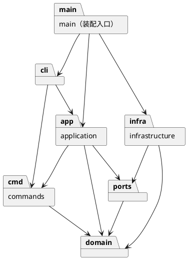

# Lab1 Phase 1：SVG 编辑器（CLI）

> 当前为提交文档模板，尚不是完成报告。建议方案不代表已实现；提交前请根据真实代码、讨论记录与测试结果填写所有“待填写”项，并删除本提示。需求依据：课程说明 `phase_cli_1.md`。

## 1. 架构方案

### 1.1 本阶段范围

使用 TypeScript，以面向对象方式实现 SVG 命令行编辑器，并与 AI 智能体协作完成。必须采用 Command 模式，容器与叶子采用统一操作的 Composite 语义。

功能核对清单（实现并验证后再勾选）：

- [ ] REPL 提示符为 `svg>`，逐行读取命令，支持以 `#` 开头的注释和双引号包裹的含空格参数。
- [ ] 文档操作：`init`、`read`、`save`、`canvas`；默认画布 800×600。
- [ ] 内置类型：`rect`、`circle`、`ellipse`、`line`、`text`、`g`。
- [ ] 编辑操作：`create`、`delete`、`move`、`scale`、`set`、`group`、`ungroup`、`addto`、`front`、`back`。
- [ ] 所有类型的 `create` 支持尾缀 `in <containerId>`。
- [ ] 显示操作：`tree [id]`、`show <id>`、`help`；树形输出内联关键几何属性。
- [ ] `undo` / `redo`：一条编辑命令为一个撤销单元；撤销后成功执行新编辑会清空 redo 栈。
- [ ] `init`、`read`、`save` 和修改尺寸的 `canvas` 执行后禁止 undo/redo，直到下一次编辑命令重新解禁；显示命令不进入 undo 栈。
- [ ] 所有图形及 `g` 的 id 唯一且大小写敏感；CLI 创建时显式指定，读取外部 SVG 时为缺失 id 的元素补充“标签名+序号”并打印警告。
- [ ] 错误以 `error:` 开头，一行一条；失败命令不改变任何状态；编辑成功输出摘要。
- [ ] SVG 可保存、读回，并在浏览器中预览。

本阶段不实现 `box`、ShapeProvider 插件系统及版本 B 示例；`create box` 应报告未知类型。实现版本 A 的普通 `g` + `rect` + `text` 组合即可覆盖流程图案例。

关键语义：

- `move` 使用增量；容器移动时整体移动。
- `scale` 的正数因子作用于全部几何属性，包括位置与尺寸；容器递归处理所有子孙。
- `set` 只允许说明中列出的公共样式、各类型几何属性及 text 的 `text` 内容；不得自行开放任意属性。
- `delete` 删除容器时同时删除其全部子孙。
- `group` 收编已有图形，从原父容器摘出并保持相对顺序；不得同时收编某容器及其子孙。
- `ungroup` 将子节点提升至父级并占据原容器的位置；按课程规定，禁止解散直接位于 svg 下的顶层容器。
- `addto` 将已有图形追加为目标容器的最后一个子节点。
- `front` / `back` 只调整同级图形的 z-order。
- 省略 fill / stroke 时不写出对应属性，遵循 SVG 默认渲染。

### 1.2 模块划分

以下为建议方案，需结合最终代码修改。类名、目录和职责必须能够在实现中找到对应内容。

| 模块（建议目录） | 职责 |
| --- | --- |
| `src/cli/` | REPL、参数解析、命令分发、统一反馈与错误输出 |
| `src/application/` | 当前文档、用例协调、撤销/重做历史与文档操作后的禁用状态 |
| `src/commands/` | Command 接口和具体编辑命令，保存执行与撤销需要的信息 |
| `src/domain/` | 图形类层次、容器、文档、id 与树结构约束、几何及属性行为 |
| `src/ports/` | 文件存储等外部能力的接口 |
| `src/infrastructure/` | SVG 解析与序列化、文件读写，提供 ports 的实现 |
| `src/main.ts` | 创建对象、连接模块、启动程序 |
| `tests/` | 单元、集成及命令会话回归测试 |

建议包图（按最终实现调整；课程要求 PlantUML 组件图或包图）：

### 1.3 设计模式的选择与落地

| 模式/机制 | 选择原因 | 实际落地（实现后填写） |
| --- | --- | --- |
| Command（课程强制） | 将编辑请求封装为对象，统一执行及撤销；一次 group 也只形成一个历史单元 | 待填写：接口、具体命令类、历史管理类及代码位置 |
| Composite 语义（课程要求） | 用统一抽象操作叶子和容器；容器负责对子树应用行为，避免命令层逐类型分派 | 待填写：图形基类/接口、叶子类、容器类及代码位置 |
| 图形工厂（建议） | 集中负责类型名到图形对象的创建 | 待填写：工厂类及代码位置 |

实现约束：类层次、多态、字段封装、一类一文件且文件名与类名一致。禁止公共数据袋式贫血模型、过程式自由函数及到处 `switch(tag)` 的分派。

按名字分派只允许出现在命令分发和图形工厂两处。按课程要求，将这两处标注为待重构点：待填写实际位置、后续替换为注册机制的条件与计划。本阶段不要求完成插件系统。

### 1.4 依赖方向规则

以下规则对应上述建议方案：

1. `domain` 不依赖 CLI、命令、应用协调层或文件系统，保持图形行为可独立测试。
2. `commands` 依赖 `domain`，通过对象行为编辑图形；不直接处理终端或文件读写。
3. `application` 依赖 `commands`、`domain`、`ports`，通过接口使用外部能力。
4. `cli` 依赖应用入口与命令构建接口，不直接修改图形内部字段。
5. `infrastructure` 实现 `ports`，可依赖 `domain` 完成解析与序列化；内部模块不得反向依赖具体文件存储实现。
6. `main.ts` 作为装配入口可连接具体实现。其依赖属于明确允许的装配职责。

待填写：最终规则的调整及理由。发现违反规则的依赖时，列入第 3 节待处理项。

### 1.5 变化点假设

以下为建议，需要写明自己的实际选择。

| 可能的变化 | 建议预留/暂不预留的方式 | 最终决策与代码依据 |
| --- | --- | --- |
| 新增图形类型或未来支持 box | 集中创建入口，使用图形多态；本阶段不实现完整插件加载 | 待填写 |
| 新增编辑命令 | 通过 Command 接口扩展，集中管理历史 | 待填写 |
| 增加 GUI 或 agent 输入通道 | 将终端解析与图形行为分离，保留统一 id 定位方式 | 待填写 |
| 更换存储介质或扩展 SVG 支持范围 | 经存储接口隔离文件 IO，集中解析与序列化 | 待填写 |
| 更复杂的撤销策略 | 先满足当前原子操作与还原要求，不提前实现分支历史 | 待填写 |

### 1.6 需求歧义与实现决策

以下细节在说明中未完全明确，应记录采用的解释；影响验收时向教师确认：

- 跨父容器 `group` 后新容器放在哪里、不同父容器之间的顺序如何定义。
- IO 操作后的历史是否清空，解禁后允许撤销到什么边界。
- 外部 SVG 中 transform、未知标签/属性、重复 id 的处理范围与策略。
- 未 init/read 时，`help` 是否作为无需文档的例外。
- `init` 后首次无参数 `save`、缺少部分可选尺寸参数时的行为。

待填写：实际决策、理由及确认依据。不要将自行选择的策略写成课程明确要求。

## 2. 过程记录

记录真实、关键、有代表性的 AI 协作讨论与迭代，无需粘贴全部聊天。以下表格为空白记录结构，不代表已经发生。

| 日期/迭代 | 问题或目标 | AI 的建议/产物 | 我的判断与发现的问题 | 如何确认并纠正 | 对应 commit/证据 |
| --- | --- | --- | --- | --- | --- |
| 待填写 | 待填写 | 待填写 | 待填写 | 待填写 | 待填写 |

可记录的实际事件包括：AI 将缩放理解成只改尺寸、遗漏容器递归、撤销未恢复原顺序、架构图与实际依赖不符等。仅在确实发生时填写。

### 方案修订记录

| 日期 | 原方案 | 实际修改 | 修改理由 | 相关代码/commit |
| --- | --- | --- | --- | --- |
| 待填写 | 待填写 | 待填写 | 待填写 | 待填写 |

## 3. 一致性自查

### 3.1 模块划分

- 实际目录与方案是否一致：待填写。
- 不一致之处：待填写；没有则写“无”，并给出核对依据。
- 是否记入修订记录：待填写。

### 3.2 依赖方向

| 抽查代码位置 | 实际依赖关系 | 对应规则 | 是否符合 | 处理结果 |
| --- | --- | --- | --- | --- |
| 待填写 | 待填写 | 待填写 | 待填写 | 待填写 |

待处理项：待填写；确认无违规后再写“无”。

## 4. 质量保证手段

### 4.1 运行与复现

- 远程仓库地址：待填写。
- Node.js / TypeScript 版本：待填写实际使用版本。
- 依赖安装命令：待填写。
- 启动命令：待填写（课程会话示例使用 `npm run cli`）。
- 测试、类型检查等命令：待填写真实可运行的命令。
- 最终提交 commit 与 `final` tag：待填写，并确认代码和 tag 已推送到远程。

### 4.2 功能完整性的验证

以下为计划，执行后填写真实结果和证据：

| 验证范围 | 应验证的关键行为 | 结果与证据 |
| --- | --- | --- |
| 类型与参数 | 六种内置类型、可选样式、浮点坐标、含空格/中文文本、create in | 未执行 |
| 层级与容器 | 嵌套容器移动/缩放/删除，group、ungroup、addto，原父级及顺序 | 未执行 |
| 属性与层叠 | set 白名单、文字内容、同级 front/back | 未执行 |
| 历史 | 编辑的 undo/redo、多对象操作原子撤销、新编辑清空 redo、IO 后禁用 | 未执行 |
| 失败原子性 | 重复/缺失 id、无效容器、非法属性/缩放等失败后文档及历史保持原状 | 未执行 |
| SVG 读写 | 缺 id 补齐警告、文件错误、保存后读回保持支持范围内的结构与属性 | 未执行 |
| 显示 | tree 子树及内联属性、show 父级与属性、help 语法 | 未执行 |
| 端到端 | 回放课程第 6 节与第 6.1 节版本 A，会话结果核对及浏览器预览 | 未执行 |

### 4.3 代码质量的依据

待填写真实执行结果：类型检查、必要的自动化测试、人工代码审查、模块依赖抽查，以及如何确认字段封装、图形多态与一类一文件要求。测试通过数、覆盖率和截图必须来自实际运行。

### 4.4 已知限制

待填写未实现项、已知缺陷、需求解释及影响；不得将本阶段必做但未完成的功能描述为可选功能。
